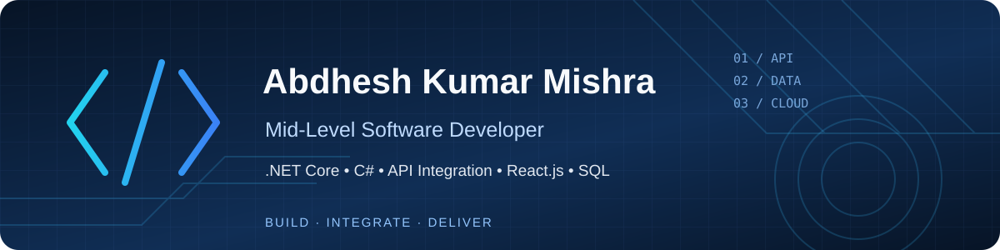

  

<h1 align="center">Abdhesh Kumar Mishra</h1>
<h3 align="center">Mid-Level Software Developer | .NET Core · C# · API Integration · React.js</h3>

  <a href="mailto:abdheshmishraa@gmail.com">Email</a> ·
  <a href="https://github.com/abdheshmishra">GitHub</a>

---

## Professional Summary

Software developer with **5+ years of experience** building, integrating, and supporting business applications, primarily in the banking domain. Experienced in backend development, REST API integration, relational database design, troubleshooting, and application delivery.

I enjoy translating business requirements into reliable, maintainable software and collaborating with teams to solve practical problems. I am interested in contributing to impactful digital services and continuously improving my engineering skills.

## Technical Skills

| Area | Technologies |
|---|---|
| **Backend** | C#, .NET Core, ASP.NET MVC Core, ASP.NET Web API |
| **Frontend** | React.js, JavaScript, HTML5, CSS3, Bootstrap |
| **Databases** | Microsoft SQL Server, PostgreSQL |
| **API & Integration** | REST APIs, third-party integration, BPM integration, XML processing |
| **DevOps & Delivery** | Git, GitHub, Docker, CI/CD, application hosting and deployment |
| **Data** | Data engineering fundamentals, data warehouse, data lake |
| **Engineering Practices** | Debugging, testing, query optimization, documentation, production support |

  

## Selected Project Experience

My professional experience includes developing and supporting enterprise applications in areas such as:

- Transaction processing, card and POS settlement
- Reconciliation and financial reporting
- Deposit reporting and loan-related workflows
- Document tracking and business process automation
- Data exchange, XML conversion, and system integration

Some of this work was completed in employer environments. Its source code, data, and implementation details are not published here.

### Personal Full-Stack Projects

- **Bus Ticket Booking Application** — Full-stack booking application using a React.js frontend, .NET Web API backend, and PostgreSQL database.
- **Pharmacy Billing Application** — Billing application using a React.js frontend, .NET Web API backend, and PostgreSQL database.

These projects reflect my interest in building practical, database-driven applications across the full stack.

## What I Bring

- Building maintainable backend services and REST APIs
- Integrating applications and exchanging data reliably
- Designing relational databases and writing efficient SQL queries
- Troubleshooting issues and supporting applications in production
- Working with cross-functional teams to deliver business requirements
- Learning modern development, deployment, and data practices

## GitHub Activity

  
  

## Let's Connect

- **Email:** [abdheshmishraa@gmail.com](mailto:abdheshmishraa@gmail.com)
- **GitHub:** [github.com/abdheshmishra](https://github.com/abdheshmishra)
- **Location:** Kathmandu, Nepal

---

<i>Building practical software solutions, improving continuously, and contributing as part of a team.</i>

